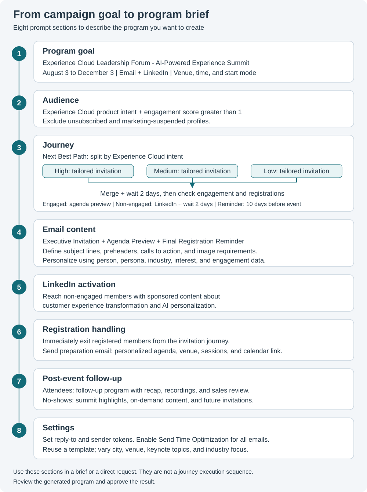

# [!DNL CX Enterprise Coworker] in [!DNL Adobe Marketo Optimizer] {#coworker-overview}

[!DNL CX Enterprise Coworker] Chat ist eine Gesprächsoberfläche zum Ausführen von Aufgaben in [!DNL Adobe Marketo Optimizer]. Beschreiben Sie ein Ziel in einfacher Sprache, planen [!DNL Coworker] die Aufgaben, führen Sie sie in [!DNL Marketo Optimizer] aus, validieren Sie die Ergebnisse und stellen Sie die fertige Arbeit für Ihre Genehmigung bereit.

[!DNL Coworker] verwendet für [!DNL Marketo Optimizer] entwickelte Fähigkeiten, um Sie durch gängige Aufgaben im Rahmen von Marketing-Vorgängen zu führen: Erstellen eines neuen Programms, Anpassen eines vorhandenen [!DNL Marketo Engage]-Programms und Überprüfen, ob Ihre Daten für KI-Entscheidungen bereit sind.

[!DNL Coworker] respektiert die bestehenden Berechtigungen [[!DNL Marketo Optimizer]  Organisation](../start/permissions-reference.md). Sie können nur Aktionen ausführen, zu denen Sie bereits berechtigt sind, und Administratoren können steuern, wann Sie Schreibzugriff haben. [!DNL Coworker] ist Teil des Adobe-Ökosystems und nicht auf [!DNL Marketo Optimizer] beschränkt.

Weitere Informationen finden Sie unter:

* [[!DNL Adobe CX Enterprise Coworker] Chat - Übersicht](https://experienceleague.adobe.com/en/docs/coworker/content/chat/overview)
* [Chat-Oberfläche in [!DNL Marketo Optimizer]](./chat-interface.md)
* [[!DNL Coworker] Kenntnisse in [!DNL Marketo Optimizer]](./skills.md)

## [!DNL Marketo Optimizer] in [!DNL CX Enterprise Coworker] {#skills}

Verwenden Sie die folgenden produktspezifischen Fähigkeiten, um Programme zu erstellen und anzupassen oder die Datenbereitschaft zu bewerten.

| Skill | Was es Ihnen hilft zu tun | Beispielanfrage |
| --- | --- | --- |
| `program-creation-marketo-optimizer` | Erstellen Sie ein [!DNL Marketo Optimizer] Marketing-Programm von Anfang bis Ende. [!DNL Coworker] führt Sie von Ihrem Ziel bis zu einem erstellten Programm. | Laden Sie eine Kampagnenbeschreibung hoch und fragen Sie dann: _Erstellen Sie ein Programm unter Verwendung der angehängten Zusammenfassung._ |
| `adapt-program-marketo-optimizer` | Anpassen, Migrieren oder Konvertieren eines vorhandenen [!DNL Marketo Engage]-Programms in ein [!DNL Marketo Optimizer]. | _Passen Sie unser Webinar-Programm für Unternehmen im 3. Quartal von [!DNL Marketo Engage] in [!DNL Marketo Optimizer] an._ |
| `ai-decisioning-health-marketo-optimizer` | Melden Sie, ob die Daten Ihres Mandanten für KI-Entscheidungen bereit sind, einschließlich Story-Abdeckung, Reichhaltigkeit der Eigenschaften und persönlicher Abdeckung. | _Welche Daten werden für die KI-Entscheidungsfindung verwendet?_ |

### Eingabeaufforderung zur Programmerstellung eines Beispiels {#program-creation-prompt}

Laden Sie eine Zusammenfassung hoch oder beschreiben Sie das Programm direkt. Schließen Sie die Zielgruppe, das Journey, den Inhalt und die Einstellungen ein, die Sie verwenden [!DNL Coworker].

Das Diagramm fasst die Eingabeaufforderungsabschnitte im folgenden Beispiel zusammen. Hier wird gezeigt, wie die Anfrage organisiert wird, und nicht in der Reihenfolge, in der sich Personen über die Journey bewegen.

{width="800" zoomable="yes"}

Erweitern Sie jeden Abschnitt, um die Beispielaufforderung anzuzeigen.

+++Programmziel

_Erstellen Sie ein B2B-Marketing-Programm mit dem Namen Experience Cloud Leadership Forum - KI-gestützter Erlebnis-Summit, das vom 3. August bis zum 3. Dezember läuft, mithilfe von E-Mail und LinkedIn. Die Veranstaltung findet um 9:00 Uhr im Bay Area Innovation Center statt. Starten Sie die Journey sofort._

+++

+++Zielgruppe

_Targeting von Personen mit einer beliebigen Produktabsicht für Experience Cloud und einem Interaktionswert von mehr als 1. Ausschließen von abgemeldeten und vom Marketing ausgesetzten Profilen._

+++

+++Journey

_Verwenden Sie den nächstbesten Pfad, um die Zielgruppe nach dem hohen, Medium- und niedrigen Experience Cloud-Intent aufzuteilen. Senden Sie personalisierte E-Mail-Einladungen, die auf jede Absichtsebene zugeschnitten sind. Pfade zusammenführen und zwei Tage warten. Überprüfen Sie E-Mail-Öffnungen, Klicks, Inhaltsinteraktion und Registrierungen. Senden Sie eine Tagesvorschau an engagierte Mitglieder; aktivieren Sie nicht interaktive Mitglieder auf LinkedIn und warten Sie zwei Tage. Zusammengeführte Pfade zusammenführen und eine endgültige Registrierungserinnerung 10 Tage vor dem Ereignis senden. Versandzeitoptimierung für alle E-Mails aktivieren._

+++

+++E-Mail-Inhalt

_Erstellen Sie drei E-Mails: Einladung an Führungskräfte (6 Wochen vor der Veranstaltung), Agenda-Vorschau (6 Wochen vor der Veranstaltung) und endgültige Registrierungs-Erinnerung (10 Tage vor der Veranstaltung). Geben Sie relevante Betreffzeilen, Preheader, Aktionsaufrufe (reservieren Sie meinen Platz, Agenda anzeigen, vollständige Registrierung) und KI-personalisierten Inhalt mit Personen-Story, Persona-Klassifizierung, Branche, Lösungsinteresse, kürzlich durchgeführte Interaktionen und Experience Cloud-Absichten an. Fügen Sie der Einladung ein Veranstaltungsbild, aber kein Banner in die Tagesvorschau ein._

+++

+++LinkedIn

_Targeting von nicht interaktiven Mitgliedern mit gesponserten Inhalten, die die Umwandlung von Kundenerlebnissen und die KI-Personalisierung fördern._

+++

+++Registrierung

_Verlassen Sie registrierte Mitglieder sofort von der Einladungs-Journey und senden Sie eine E-Mail zur Vorbereitung an Führungskräfte mit KI-generierten Diskussionsthemen, einer personalisierten Tagesordnung, Details zum Veranstaltungsort, empfohlenen Sitzungen und einem Kalenderlink._

+++

+++Nach dem Ereignis

_Führen Sie Teilnehmer zum Experience Cloud Leadership Follow-Up-Programm mit einer Zusammenfassung, Aufzeichnungen, Ressourcen und einer Überprüfung der Vertriebsqualifizierung. Senden Sie Highlights des No-Shows-Gipfels, On-Demand-Inhalte und zukünftige Ereigniseinladungen._

+++

+++Einstellungen

_Legen Sie my.replyToEmail auf `events@example.com` und my.senderName auf Experience Cloud Events fest. Verwenden Sie eine wiederverwendbare Vorlage, bei der nur Stadt, Veranstaltungsort, Grundsatzthemen und Änderungen des Branchenfokus möglich sind._

+++

Weitere Informationen zur Vorbereitung einer Zusammenfassung finden Sie unter [Erstellen eines Programms aus einer Zusammenfassung](./program-from-brief.md).

## Beispielhafte Anwendungsfälle {#use-cases}

### Erstellen eines Programms nach Überprüfung der Datenbereitschaft {#check-readiness-create-program}

Ein Lead von Marketing-Vorgängen möchte wissen, ob der Mandant für KI-Entscheidungen bereit ist, bevor er ein neues kontobasiertes Programm erstellt.

1. Um die Abdeckung von Stories, die Reichhaltigkeit von Eigenschaften und die persönliche Abdeckung zu überprüfen, führen Sie den [KI-Entscheidungs-Konsistenzcheck](./ai-decisioning-health.md) aus. Fragen Sie beispielsweise: _Anzeigen der für KI-Entscheidungen genutzten Marketo-Daten._
1. Behebung etwaiger im Bericht festgestellter Lücken.
1. Laden Sie eine Kampagnenbeschreibung hoch und fragen Sie: _Erstellen Sie ein Programm mit der angehängten Zusammenfassung._
1. Überprüfen und genehmigen Sie das Programm, wenn [!DNL Coworker] das Ergebnis vorlegt.

Das Ergebnis ist ein Bereitschaftsbericht, der Mängel identifiziert, gefolgt von einem Programm, das auf Daten basiert, die KI-Entscheidungen unterstützen können.

### Verschieben eines vorhandenen [!DNL Marketo Engage]-Programms nach [!DNL Marketo Optimizer] {#adapt-program}

Ein Demand Generation-Team wünscht sich ein bewährtes Programm, das in [!DNL Marketo Optimizer] ausgeführt wird, ohne es manuell neu zu erstellen.

1. Benennen Sie das [!DNL Marketo Engage] Programm, das angepasst werden soll. Beispiel: _Anpassen des Webinar-Programms für Unternehmen im 3. Quartal von [!DNL Marketo Engage] in [!DNL Marketo Optimizer]._
1. [!DNL Coworker] ordnet das Programm [!DNL Marketo Optimizer] Konstrukten zu und markiert alles, was nicht konvertiert werden kann.
1. Überprüfen Sie das Ergebnis und genehmigen Sie es.

Das Ergebnis ist ein konvertiertes Programm für Ihre Überprüfung sowie eine Liste von Elementen, für die eine manuelle Entscheidung erforderlich ist.

## [!DNL Marketo Optimizer] MCP-Tools {#mcp-tools}

[!DNL Coworker] Kenntnisse rufen die folgenden 37 Tools auf dem [!DNL Marketo Optimizer] Model Context Protocol (MCP)-Server auf. Jeder Tool-Name trägt das Präfix `marketo-optimizer__`.

Diese Referenz behandelt Tools, die durch registrierte Fähigkeiten dokumentiert wurden, einschließlich unterstützender Fähigkeiten, die während eines Workflows verwendet wurden. Er gibt weder den Bereitstellungsstatus noch die Nutzungshäufigkeit an. Die Namen der Kenntnisse in dieser Tabelle folgen der Tool-Referenz und können von den oben aufgeführten produktspezifischen Namen der Kenntnisse abweichen.

| Tool | Skills | Zweck |
| --- | --- | --- |
| `marketo-optimizer__get_workspace_root_tree` | `program-creation-marketo-optimizer` | Suchen Sie die Workspace-Zone oder den benannten Unterordner für ein neues Programm. |
| `marketo-optimizer__create_program` | `program-creation-marketo-optimizer` | Erstellen Sie ein Programm im bestätigten Bereich oder Ordner. |
| `marketo-optimizer__list_programs` | `program-creation-marketo-optimizer`, `landing-page-authoring` | Durchsuchen Sie Programme oder suchen Sie, wo Sie eine Landingpage ablegen können. |
| `marketo-optimizer__get_program` | `program-creation-marketo-optimizer` | Lesen eines Programms nach ID. |
| `marketo-optimizer__update_program` | `program-creation-marketo-optimizer` | Aktualisieren Sie die Programmmetadaten, z. B. den Namen. |
| `marketo-optimizer__create_program_token` | `program-creation-marketo-optimizer` | Erstellen oder korrigieren Sie ein Token für ein genehmigtes Programm. |
| `marketo-optimizer__list_program_tokens` | `program-creation-marketo-optimizer` | Lesen der aufgelösten Token eines Programms. |
| `marketo-optimizer__create_dynamic_people_list_with_rules` | `program-creation-marketo-optimizer` | Erstellen Sie eine programmverknüpfte Personenliste und generieren Sie Zielgruppenregeln aus einer Beschreibung. |
| `marketo-optimizer__list_people_journeys` | `adapt-program`; Gemeinsame Referenz zum Kanal-Plug-in | Suchen Sie nach einer Journey-Namenskollision, suchen Sie nach einem unklaren Ergebnis eine vorhandene Journey oder durchsuchen Sie die Journey nach Kanalarbeit. |
| `marketo-optimizer__create_person_journey` | `program-creation-marketo-optimizer`, `adapt-program`, `channel-content-authoring` | Erstellen Sie eine programmverknüpfte Journey, starten Sie eine angepasste Journey oder erstellen Sie eine fehlende Journey für einen E-Mail-Kanal. |
| `marketo-optimizer__get_person_journey` | `program-creation-marketo-optimizer`, `adapt-program`; Gemeinsame Referenz für das Kanal-Plug-in | Lesen Sie eine Journey oder ihre Arbeitsfläche, überprüfen Sie gestaffelte Bearbeitungen oder suchen Sie eine Journey für Kanalarbeiten. |
| `marketo-optimizer__update_person_journey` | `adapt-program` | Hängen Sie jeweils einen genehmigten Build-Schritt an die Ziel-Journey an. |
| `marketo-optimizer__run_person_journey_simulation` | `program-creation-marketo-optimizer` | Validieren eines Journey-Flusses ohne Veröffentlichung. |
| `marketo-optimizer__run_program_qa` | `program-creation-marketo-optimizer` | Führen Sie eine schreibgeschützte Machbarkeitsprüfung für das Programm und seine Journeys durch. |
| `marketo-optimizer__create_channel` | `channel-content-authoring`; `program-creation-marketo-optimizer` und `image-to-html` durch Übergabe | Erstellen und Verknüpfen eines Kanals. Für E-Mails werden im ersten Aufruf Vorlagen aufgelistet und im zweiten die ausgewählte Vorlage zum Erstellen und Verknüpfen der E-Mail verwendet. |
| `marketo-optimizer__get_channel` | `channel-content-authoring` | Lesen Sie einen Kanal, optional einschließlich E-Mail-Betreff und HTML. |
| `marketo-optimizer__list_channels` | `channel-content-authoring` | Kanäle nach Typ durchsuchen, optional nach Namen gefiltert. |
| `marketo-optimizer__update_channel_content` | `channel-content-authoring`; `image-to-html` durch Übergabe | Aktualisieren des Betreffs oder der HTML einer E-Mail, einschließlich der Anwendung von konvertiertem HTML. |
| `marketo-optimizer__image_to_html` | `image-to-html` | Starten Sie eine asynchrone E-Mail-Design-Konversion und rufen Sie die bearbeitbare HTML ab. |
| `marketo-optimizer__list_asset_library_images` | `landing-page-authoring` | Suchen Sie nach Ersatzbildern für Landingpage-Slots. |
| `marketo-optimizer__add_asset_to_program_or_folder` | `landing-page-authoring` | Registrieren Sie eine neue Landingpage im ausgewählten Optimizer-Programm oder -Ordner. |
| `marketo-optimizer__get_person_story` | `personalization-engine-health` | Personalisierungsgeschichte nach numerischer ID lesen. |
| `marketo-optimizer__get_persona_story` | `personalization-engine-health` | Lesen Sie die Story für einen exakten Personennamen. |
| `marketo-optimizer__run_arbitration` | `personalization-engine-health` | Journey für die Qualifizierung von Personen nach expliziter Bestätigung neu bewerten und auswählen. |
| `marketo-optimizer__get_arbitration_summary` | `personalization-engine-health` | Lesen Sie die Zusammenfassungsstatistiken für die letzte Schlichtungsausführung. |
| `marketo-optimizer__get_arbitration_decisions` | `personalization-engine-health` | Pro Person getroffene Entscheidungen aus dem letzten Schlichtungsdurchgang lesen. |
| `marketo-optimizer__get_ai_decisioning_health_summary` | `ai-decisioning-health` | Abrufen des Gesamtberichts zur Mandantenbereitschaft. |
| `marketo-optimizer__get_persona_distribution` | `ai-decisioning-health` | Anzahl und Prozentsätze der Persona melden. |
| `marketo-optimizer__get_people_without_personas` | `ai-decisioning-health` | Melden Sie die Anzahl und den Anteil der Personen ohne Rolle. |
| `marketo-optimizer__get_person_story_attribute_coverage` | `ai-decisioning-health` | Erfassung von Eigenschaftskategorien messen und ausgefüllte Felder identifizieren. |
| `marketo-optimizer__get_person_story_data_completeness` | `ai-decisioning-health` | Berichte zu Reichhaltigkeit, Vollständigkeit und Variation nach Rolle erstellen. |
| `marketo-optimizer__get_person_story_coverage` | `ai-decisioning-health` | Berichterstattung, Berichterstattung, Trends und ausstehende Erstellung. |
| `marketo-optimizer__get_personalization_story_pipeline_status` | `ai-decisioning-health` | Pipeline-Status, Ausführungsverlauf und Berichtsdauer lesen. |
| `marketo-optimizer__get_person_story_refresh_backlog` | `ai-decisioning-health` | Zählen der Storys, die aufgrund geänderter Quelldaten auf Aktualisierung warten |
| `marketo-optimizer__get_person_intent_signal_coverage` | `ai-decisioning-health` | Messen Sie die Produktabsicht, die Keyword-Absicht und die Aktivitätsabdeckung. |
| `marketo-optimizer__get_person_story_activity_coverage` | `ai-decisioning-health` | Erfasste Interaktionsfelder und aggregierte Aktivitätstrends melden. |
| `marketo-optimizer__get_person_audience_membership_distribution` | `ai-decisioning-health` | Geben Sie den Durchschnitt und die Verteilung der Zielgruppenzugehörigkeiten pro Person an. |
