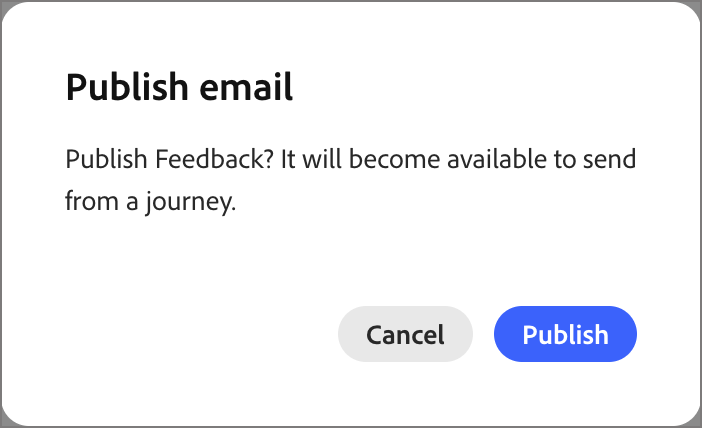

# Erstellen von E-Mails und Hinzufügen zu Journeys

[!DNL Adobe Marketo Optimizer] bietet B2B-Marketing-Experten ein modernes, unternehmenstaugliches Erlebnis für E-Mail-Erstellung und -Versand, sodass Sie E-Mails aus Ihren Programmen und Journey erstellen, veröffentlichen und senden können.

E-Mails sind eigenständige Assets, sodass Sie keine Journey benötigen, um eine zu erstellen. [Erstellen Sie eine E](#create-email-from-programs)Mail in einem Programm oder einem seiner Ordner, [veröffentlichen Sie sie](#publish-email) wenn sie bereit ist, und [ Sie sie dann von einer beliebigen Journey in diesem Programm](#add-email-from-journey).

## E-Mail-Lebenszyklus {#lifecycle}

Eine E-Mail befindet sich immer in einem der folgenden Status:

| Land | Beschreibung |
| ----- | ----------- |
| **Entwurf** | Jede neue E-Mail beginnt als Entwurf, der mit einem roten Umschlagsymbol in der Programmstruktur angezeigt wird. Sie können die Eigenschaften, Aktionen und Inhalte bearbeiten und personalisieren, analysieren, umbenennen oder löschen. |
| **Veröffentlicht** | Eine veröffentlichte E-Mail ist gesperrt und kann gesendet werden. Sie wird mit einem grünen Umschlagsymbol angezeigt. Sie kann nicht bearbeitet oder die Veröffentlichung rückgängig gemacht werden und wird beim Auswählen einer E-Mail auf einer Journey angezeigt. |
| **In einer Journey** | Wenn Sie in der Aktion _E-Mail senden_ eine veröffentlichte E-Mail auswählen, wird eine veröffentlichte Kopie erstellt, die zur Journey gehört. Die Kopie ist schreibgeschützt und ändert sich nicht, wenn das Original später dupliziert und überarbeitet wird. |

Eine E-Mail wird beim Veröffentlichen von Entwurf in Veröffentlichung verschoben. Bei Auswahl für den Aktionsknoten _E-Mail senden_ befindet sich eine Kopie auf der Journey. Um eine veröffentlichte E-Mail zu ändern, [duplizieren](#duplicate-email). Das Duplikat wird als Entwurf mit demselben Inhalt und denselben Einstellungen erstellt.

{width="800" zoomable="yes"}

Der E-Mail-Status bestimmt die Verfügbarkeit der Aktion:

| Aktion | Entwurf | Veröffentlicht | In einer Journey |
| ------ | ----- | --------- | ------------ |
| Eigenschaften, Aktionen und Inhalte bearbeiten | Ja | Nein | Nein |
| E-Mail personalisieren | Ja | Nein | Nein |
| E-Mail analysieren | Ja | Nein | Nein |
| Veröffentlichen | Ja, nachdem die Sperrwarnungen aufgelöst wurden | Bereits veröffentlicht | Automatisch veröffentlicht |
| Duplizieren | Ja | Ja | Nein |
| Umbenennen | Ja | Nein | Nein. Sie benennen die Kopie, wenn Sie sie auswählen. |
| Löschen | Ja | Nein | Nein. Löschen Sie stattdessen _Knoten_ E-Mail senden“. |
| In einer Journey auswählen | Nein | Ja | Nicht zutreffend |

## Voraussetzungen {#before-you-begin}

Stellen Sie sicher, dass Ihre Benutzerrolle die folgenden [Produktberechtigungen](../start/permissions-reference.md) für die von Ihnen ausgeführten Aufgaben enthält:

* **[!UICONTROL B2B-]** anzeigen und **[!UICONTROL B2B-Ordner anzeigen]** - Anzeigen der Programme und Ordner, in denen E-Mails gespeichert sind.
* **[!UICONTROL B2B-E-Mails anzeigen]** - E-Mail-Nachrichten anzeigen.
* **[!UICONTROL Verwalten von B2B]** E-Mails - Erstellen, Bearbeiten, Duplizieren, Umbenennen, Löschen und Veröffentlichen von E-Mails.
* **[!UICONTROL B2B-Personen-Journey verwalten]** - Hinzufügen oder Ersetzen von E-Mail-Aktionen in einer Personen-Journey. Verwenden Sie für schreibgeschützten Zugriff auf Journey „B2B-Personen **[!UICONTROL Journey anzeigen]**.
* **[!UICONTROL Verwalten des B2B-]**-Erlebnisses - Zugriff auf [!DNL Coworker] zum Personalisieren oder Analysieren einer E-Mail. Für Aktionen in [!DNL Coworker] sind außerdem die entsprechenden E-Mail-Berechtigungen erforderlich.

Zusätzliche Berechtigungen sind nur erforderlich, wenn Sie die folgenden Einrichtungs- oder Sendeaufgaben ausführen:

* **[!UICONTROL B2B-Programme verwalten]** - Erstellen Sie ein Programm, wenn noch keines vorhanden ist.
* **[!UICONTROL B2B-Kanal-Konfigurationen verwalten]** und **[!UICONTROL B2B-E-Mail-Einstellungen anzeigen]** - Erstellen einer E-Mail-Kanal-Konfiguration. Admins benötigen außerdem **[!UICONTROL B2B-E-Mail-Einstellungen verwalten]**, um die Einstellungen für den E-Mail-Versand zu konfigurieren.
* **[!UICONTROL B2B-Personen-Journey veröffentlichen]** - Veröffentlichen Sie die Journey, die die E-Mail sendet.

Bevor Sie eine E-Mail erstellen, bestätigen Sie Folgendes:

* E-Mails befinden sich in einem Programm oder einem seiner Ordner. Definieren Sie das Programm, bevor Sie eine E-Mail erstellen. Eine Journey kann nur E-Mails aus ihrem eigenen Programm senden.
* Um eine E-Mail-Kanal-Konfiguration auszuwählen, verwenden Sie die Registerkarte **[!UICONTROL Aktionen]** . Administratoren verwalten [E-Mail-Kanalkonfiguration](../admin/email-channel-configuration.md).
* Sie können so viele E-Mails erstellen, wie Sie innerhalb eines Programms benötigen.

>[!NOTE]
>
>Wenn Sie zum ersten Mal eine E-Mail senden, stellen Sie sicher, dass [E-Mail-Zustellbarkeit](../start/email-deliverability.md) und der erforderliche [E-Mail-Kanal](../admin/email-channel-configuration.md) konfiguriert sind.

<!-- 
* **Email channel configurations** - Manage the sender identity, reply behavior, marketing vs. transactional message types, and tracking.
* **Email deliverability controls** - Set up your email deliverability channel, including subdomain delegation (Fully Delegated and CNAME methods), DMARC, SPF/DKIM auto-configuration, and shared IP pool support.
* **Send Email action** - From a journey, add a _Send email_ action node, including personalization using profile attributes (Handlebars syntax).
* **Visual drag-and-drop email design tools** -  Design your email content with structures, content components, themes, dark-mode support, and reusable visual fragments.
* **Marketo Design Studio assets** — Choose images and assets from a one-time copy of your Marketo Engage asset library directly inside the email canvas.
* **Reusable templates and fragments** — Save common headers, footers, CTAs, and full email layouts and reuse them across journeys.
* **Role-Based Access Control (RBAC)** — Apply granular permissions for creating, editing, approving, and sending email. 
-->

>[!BEGINSHADEBOX]

## Aktuelle Einschränkungen {#limitations}

* **Testprofile, Inhalt simulieren und Testversand durchführen** sind in der aktuellen Version nicht verfügbar. Litmus-Rendering- und SpamAssassin-basierte Spam-Berichte sind für eine zukünftige Version geplant.
* **Personalisierung auf Kontoebene und benutzerdefinierte Objektdaten** sind in der aktuellen Version nicht verfügbar. Verwenden von Profilattributen.
* **Automatisierte Migration von Velocity zu Handlebars** von vorhandenen [!DNL Marketo Engage]-Vorlagen ist auf Anfrage verfügbar.
* **E-Mail-Kommentare und Zusammenarbeit** (Inline-Kommentare, @mentions, Workflow für die Überprüfung von Anfragen) sind für eine zukünftige Version geplant.
* Integrationen von **AEM Assets, AEM-Inhaltsfragmenten und Adobe Express** sind für eine zukünftige Version geplant.

>[!ENDSHADEBOX]

## Schlüsselkonzepte {#key-concepts}

Bevor Sie E-Mails für Personen-Journey erstellen und E-Mail-Inhalte verfassen, sollten Sie die folgenden Konzepte überprüfen:

| Konzept | in [!DNL Adobe Marketo Optimizer] |
| ------- | ---------------------- |
| **_[E-Mail-Design-Bereich](../content/email-authoring.md#email-design-tools)_** | Die visuelle Arbeitsfläche und Design-Tools, die zum Erstellen von E-Mail-Inhalten verwendet werden. Es enthält Layout-Komponenten, Vorlagen, Fragmente und Designs per Drag-and-Drop und einen Personalisierungseditor. |
| **_[Vorlage](../content/templates.md)_** | Ein wiederverwendbares E-Mail-Layout, das zum Erstellen einer neuen E-Mail verfügbar ist. Dabei kann es sich entweder um eine integrierte Beispielvorlage handeln, die von Adobe bereitgestellt wird, oder um eine benutzerdefinierte Vorlage, die von Ihrem Team erstellt wurde. |
| **_[Visuelles Fragment](../content/fragments.md)_** | Ein wiederverwendbarer Inhaltsblock (z. B. Kopf- und Fußzeile, CTA, Haftungsausschluss), der in mehrere E-Mails eingefügt werden kann. Beim Aktualisieren eines Fragments wird die Änderung an jede E-Mail weitergegeben, die es verwendet. |
| **_[Design](../content/email-authoring.md#design-from-scratch)_** | Eine wiederverwendbare Stilvorgabe (Farben, Typografie, Abstände, Schaltflächenstile), die auf eine E-Mail angewendet wird. |
| **_[Personalization-Token](../content/personalization-expressions.md)_** | Ein Handlebars-Ausdruck, z. B. `{{profile.firstName}}`, wird zum Sendezeitpunkt mithilfe der Profildaten jedes Empfängers aufgelöst. |
| **_[Eigenständige E-Mail](#lifecycle)_** | Ein E-Mail-Asset, das unabhängig von einer Journey vorhanden ist. Er wird in einem Programm oder einem seiner Ordner erstellt und wechselt von Entwurf zu Veröffentlichung. |
| **_[E-Mail-Typ](#email-types)_** | Die Klassifizierung, die Sie beim Erstellen einer E-Mail **[!UICONTROL (Marketing]** oder **[!UICONTROL Transaktion]** auswählen. Er gibt [!DNL Marketo Optimizer] Aufschluss darüber, wie die Nachricht zum Zweck des Einverständnisses zu behandeln ist. |
| **_[Aktion „E-Mail senden“](./action-nodes.md#add-an-action-node)_** | Der Journey-Aktionsknoten, der eine Kanalkonfiguration und E-Mail-Inhalt zum Versand einer E-Mail verwendet. |

## E-Mail-Typen {#email-types}

Wenn Sie eine E-Mail erstellen, wählen Sie ihren Typ aus. Der Typ sagt [!DNL Marketo Optimizer], wie die Nachricht für Einverständniszwecke behandelt wird. Wählen Sie daher die Nachricht aus, die dem Grund entspricht, warum Sie sie senden.

| Typ | Verwenden von für |
| ---- | ------- |
| **[!UICONTROL Marketing]** | Werbebotschaften, z. B. eine Ankündigung zum Produktstart, ein Newsletter oder eine Ereigniseinladung. |
| **[!UICONTROL Transaktion]** | Operative Nachrichten, die eine Person aufgrund von etwas erwartet, das sie getan hat, z. B. eine Bestellung, Registrierung oder Versandbestätigung. |

Der Typ wird als E-Mail **[!UICONTROL Kategorie]** auf der Registerkarte **[!UICONTROL Eigenschaften]** angezeigt.

## Erstellen einer E-Mail in der Programmstruktur {#create-email-from-programs}

Erstellen Sie eine E-Mail in einem Programm oder Ordner, um sie unabhängig von einer Journey zu erstellen.

1. Erweitern Sie in der linken Navigation **[!UICONTROL Marketing-]**) und wählen Sie **[!UICONTROL Programme]**.

1. Klicken Sie in der Programmstruktur auf das Symbol _Mehr_ (**…**) neben dem Programm oder Ordner, in dem die E-Mail erstellt werden soll, und wählen Sie **[!UICONTROL E-Mail erstellen]**.

   {width="400"}

1. Füllen _[!UICONTROL Dialogfeld „E-Mail]_&quot; die folgenden Felder aus:

   * **[!UICONTROL Parent]** - (Erforderlich) Das Programm oder der Ordner, in dem die E-Mail gespeichert wird. Es ist auf das Programm festgelegt, von dem aus Sie gestartet haben, und Sie können es in ein anderes Programm oder in einen der Programmordner ändern.

   * **[!UICONTROL E-Mail-]**: Wählen Sie **[!UICONTROL Marketing]** oder **[!UICONTROL Transaktion]** (siehe [E-Mail-Typen](#email-types)).

   * **[!UICONTROL Name]** - (Erforderlich) Geben Sie einen Namen ein, der die E-Mail in der Programmstruktur identifiziert.

   * **[!UICONTROL Beschreibung]** - (Optional) Geben Sie eine Anmerkung für Ihr Team zur E-Mail und ihrem Zweck ein.

   {width="400"}

1. Klicken Sie auf **[!UICONTROL Erstellen]**.

Die E-Mail wird in einer eigenen Registerkarte geöffnet und unter dem Programm in der Programmstruktur als Entwurf angezeigt. Solange eine E-Mail geöffnet ist, werden alle [!DNL Coworker] Eingabeaufforderungen auf diese E-Mail angewendet.

Richten Sie [die E-Mail ein](#define-email-properties), [lösen Sie alle Warnhinweise](#alerts) und [veröffentlichen Sie sie](#publish-email).

### Definieren von E-Mail-Eigenschaften und -Aktionen {#define-email-properties}

Ein E-Mail-Entwurf hat drei Registerkarten **[!UICONTROL „Eigenschaften]**, **[!UICONTROL Aktionen]** und **[!UICONTROL Inhalt]**. Ordnen Sie sie an, und speichern Sie dann Ihre Änderungen. Die E-Mail-Seite wird geöffnet, wenn Sie eine E-Mail in der Programmstruktur erstellen. Um einen Entwurf später zu öffnen, wählen Sie die E-Mail in der Programmstruktur aus.

#### Vervollständigen Sie die Registerkarten Eigenschaften und Aktionen . {#properties-actions-tabs}

1. (Optional) Geben Sie auf der **[!UICONTROL Eigenschaften]** eine **[!UICONTROL Beschreibung]** und alle anderen beschreibenden Informationen ein, die Sie für die E-Mail erfassen möchten.

   {width="800" zoomable="yes"}

1. Wählen Sie die Registerkarte **[!UICONTROL Aktionen]** und füllen Sie die Funktionseinstellungen für die E-Mail aus:

   * **[!UICONTROL E]** Mail: Wählen oder erstellen Sie eine **[!UICONTROL E-Mail-Kanalkonfiguration]**, um sie zu verwenden.

     Hierbei handelt es sich um den wiederverwendbaren Satz von E-Mail-Versandeinstellungen, der die Absenderidentität, die Antwortadresse, die Subdomain, den IP-Pool, den E-Mail-Typ (Marketing oder Transaktion) und das Tracking definiert. Klicken Sie auf _Anzeigen_-Symbol, um die Einstellungen für die ausgewählte Konfiguration zu überprüfen.

     Administratoren erstellen Konfigurationen in [E-Mail-Kanalkonfiguration](../admin/email-channel-configuration.md).

   * **[!UICONTROL Geschäftsregeln]** - (Optional) Wenden Sie Begrenzungs- oder Ruhezeitenregeln auf Ihre E-Mail-Aktion an, indem Sie einen Regelsatz auswählen.

     Weitere Informationen zu Geschäftsregeln und zum Definieren und Aktivieren von Regelsätzen für die Kanalkommunikation finden Sie unter [_Geschäftsregeln_](../admin/business-rules.md).

   * **[!UICONTROL Aktions-Tracking]** - Aktivieren Sie die Kontrollkästchen für die Aktionen, die Sie für die E-Mail verfolgen möchten.

   {width="600" zoomable="yes"}

#### Hinzufügen der Betreffzeile und des Inhalts {#content-tab}

1. Klicken Sie **[!UICONTROL Inhalt bearbeiten]** oder wählen Sie die Registerkarte **[!UICONTROL Inhalt]** aus.

   {width="500" zoomable="yes"}

1. Geben Sie **[!UICONTROL Text „Betreffzeile]** ein, den Sie im Feld Betreff für die E-Mail anzeigen möchten.

   Die Betreffzeile ist erforderlich.

   Klicken Sie auf das _Personalisieren_-Symbol (  ), um ein Personalisierungs-Token in diesem Feld zu verwenden.

1. (Optional) Aktivieren Sie das Kontrollkästchen **[!UICONTROL Größe der HTML optimieren]**, um die Größe Ihrer E-Mail-HTML während des Veröffentlichungsprozesses zu reduzieren.

   Dadurch wird verhindert, dass E-Mails in Clients wie Gmail abgeschnitten werden. Gmail kürzt Nachrichten mit einer Größe von mehr als 100 KB. Weitere Informationen finden [_unter „Optimieren der E_](#optimize-html-size) Mail-HTML-Größe“.

1. Klicken Sie auf **[!UICONTROL E-Mail-]** bearbeiten), um auf die visuellen Design-Tools zuzugreifen und mit der [Erstellung Ihres Inhalts](../content/email-authoring.md) zu beginnen.

   Alternativ können Sie auf **[!UICONTROL Code-Editor]** klicken, um Ihren eigenen Inhalt im HTML-Format zu codieren. Wenn Sie über HTML verfügen, das Sie für Ihr E-Mail-Design wiederverwenden können, können Sie es kopieren und in den Editor einfügen.

### Prüfen von Warnhinweisen {#alerts}

Die **[!UICONTROL Warnhinweise]** in der E-Mail-Kopfzeile zeigt an, wie viele Probleme [!DNL Adobe Marketo Optimizer] gefunden hat. Klicken Sie darauf, um die Liste anzuzeigen.

{width="450"}

Warnhinweise gibt es in zwei Arten:

* **Blockierungsprobleme** - Während eines dieser Probleme weiterhin besteht, ist **[!UICONTROL Veröffentlichen]** nicht verfügbar und das E-Mail-_Mehr_-Menü zeigt **[!UICONTROL E-Mail-Warnungen zur Veröffentlichung auflösen]**. Beheben Sie alle Blockierungsprobleme, bevor Sie die E-Mail veröffentlichen.

  Zu den Beispielen gehören:

  * Absendername ist leer
  * Betreffzeile fehlt
  * E-Mail-Inhalt ist leer

* **Warnungen** - Diese Hinweise machen Dinge deutlich, die es wert sind, überprüft zu werden, verhindern jedoch nicht, dass Sie veröffentlichen. Eine E-Mail kann einen Warnhinweis anzeigen und dennoch veröffentlicht werden, wenn es sich bei den verbleibenden Warnhinweisen um Warnungen handelt.

  Zu den Beispielen gehören:

  * Der Opt-out-Link ist nicht im Text der E-Mail enthalten
  * Textversion von HTML ist leer
  * Leere Links erkannt
  * E-Mail überschreitet 100 KB

## Verwalten von E-Mails in der Programmstruktur {#manage-emails}

E-Mails werden in der Programmstruktur mit einem Umschlagsymbol angezeigt. Ein roter Umschlag markiert einen Entwurf. Ein grüner Umschlag markiert eine veröffentlichte E-Mail. Klicken Sie auf das _Mehr_-Symbol (**…**) neben einer E-Mail zur Verwaltung.

{width="400"}

Das Menü für E-Mail-Entwürfe **[!UICONTROL &quot;]**&quot;, **[!UICONTROL E-Mail]**, **[!UICONTROL E-Mail analysieren]**, **[!UICONTROL Duplizieren]**, **[!UICONTROL Umbenennen]** und **[!UICONTROL Löschen]**.

Bei veröffentlichten E **[!UICONTROL Mails ist]** Option „Duplizieren“.

### E-Mail personalisieren und analysieren {#personalize-analyze}

Während eine E-Mail ein Entwurf ist, enthält ihr Menü _Mehr_ zwei Inhalts-Tools. Führen Sie sie vor der Veröffentlichung aus, da eine veröffentlichte E-Mail nicht geändert werden kann.

* **[!UICONTROL E-Mail]** - Öffnet [!DNL Coworker] mit geladener E-Mail. Um der E-Mail personalisierten Inhalt hinzuzufügen, beschreiben Sie die Zielgruppe. Weitere [_finden Sie unter „E-Mail-_](../agents/personalize-content.md) personalisieren“.

  {width="700" zoomable="yes"}

* **[!UICONTROL E-Mail analysieren]** - Prüft den bereits erstellten Inhalt. Siehe [Analysieren einer vorhandenen E-Mail](../agents/personalize-content.md#analyze-existing-email).

### Veröffentlichen einer E-Mail {#publish-email}

Veröffentlichen Sie eine E-Mail, wenn sie zum Senden bereit ist. Wenn Sie eine E-Mail in einer Journey auswählen[ werden nur veröffentlichte E](#add-email-from-journey)Mails aufgelistet.

1. Stellen Sie sicher, dass die E-Mail nicht blockiert [Warnhinweise](#alerts).

1. Klicken Sie in der Programmstruktur auf das Symbol _Mehr_ (**…**) klicken Sie neben der E-Mail auf **[!UICONTROL Veröffentlichen]**.

1. Klicken Sie im Bestätigungsdialogfeld _[!UICONTROL E-Mail veröffentlichen]_ auf **[!UICONTROL Veröffentlichen]**.

   {width="400"}

Das E-Mail-Symbol wird grün. Wenn Sie die E-Mail auswählen, wird sie in einer schreibgeschützten Ansicht geöffnet, in der ihr Inhalt, ihre Eigenschaften und ihre Aktionen zusammengefasst sind.

{width="700" zoomable="yes"}

>[!IMPORTANT]
>
>Die Veröffentlichung ist dauerhaft. Eine veröffentlichte E-Mail kann nicht bearbeitet, umbenannt, gelöscht oder an den Entwurf zurückgegeben werden. Um Änderungen vorzunehmen, [ Sie die E-Mail ](#duplicate-email).

### Duplizieren einer E-Mail {#duplicate-email}

Um eine veröffentlichte E-Mail zu ändern, duplizieren Sie sie. Um eine Variante auszuprobieren, ohne das Original zu ändern, können Sie auch einen Entwurf duplizieren.

1. Klicken Sie in der Programmstruktur auf das Symbol _Mehr_ (**…**) klicken Sie neben der E-Mail auf **[!UICONTROL Duplizieren]**.

1. Ändern Sie im Dialogfeld _[!UICONTROL E-]_ duplizieren **[!UICONTROL bei]** den Namen .

   Standardmäßig wird der ursprüngliche Name verwendet, gefolgt von `_copy`. Fügen Sie optional eine &quot;**[!UICONTROL &quot;]**.

   {width="400"}

1. Klicken Sie auf **[!UICONTROL Duplizieren]**.

Das Duplikat wird als Entwurf mit demselben Inhalt und denselben Einstellungen erstellt. Nehmen Sie die Änderungen vor, und veröffentlichen Sie sie dann.

## Hinzufügen einer E-Mail zu einer Journey {#add-email-from-journey}

Um eine E-Mail zu senden, fügen Sie sie einer Journey im selben Programm hinzu. Wenn Sie eine E-Mail auswählen, erstellt [!DNL Marketo Optimizer] eine Kopie davon für diese Journey und veröffentlicht die Kopie automatisch. E-Mails stammen aus der Programmstruktur. [Erstellen und veröffentlichen Sie die E-Mail](#create-email-from-programs) zuerst.

Sie können dieselbe E-Mail in mehreren Journey verwenden. Jedes Mal, wenn Sie sie auswählen, wird eine separate Kopie für diese Journey erstellt, und Sie können jeder Kopie einen eindeutigen Namen geben.

### E-Mail für die Aktion „E-Mail senden“ auswählen {#select-email-in-journey}

1. Öffnen Sie die Journey und wählen Sie einen Knoten [_Aktion ausführen_ aus oder fügen Sie ihn ](action-nodes.md#add-an-action-node).

1. Wählen _[!UICONTROL in „Aktion]_&quot; die Option **[!UICONTROL E-Mail senden]**.

1. Wählen _[!UICONTROL unter]_ E-Mail-Quelle“ eine der folgenden Optionen:

   * **[!UICONTROL E-Mail aus der Programmstruktur auswählen]** - Wählen Sie diese Option, um eine veröffentlichte E-Mail aus dem Programm oder seinen Ordnern von Journey zu verwenden.

   * **[!UICONTROL Verwenden einer von KI personalisierten E-]** - Wählen Sie diese Option, um eine von KI generierte E-Mail zu verwenden. Diese E-Mails sind so optimiert, dass KI-unterstützte Posteingangskunden ihre Zusammenfassungen und Antworten in Ihren Angeboten und Aktionsaufrufen vermitteln.

   {width="600"}

   Der Knoten zeigt einen leeren E-Mail-Namen an, bis Sie eine E-Mail auswählen.

1. Klicken Sie auf **[!UICONTROL E-Mail auswählen]**.

   * **_Program tree email:_** Suchen und wählen Sie im Dialogfeld _[!UICONTROL E-Mail]_ auswählen) die E-Mail aus.

     Verwenden Sie **[!UICONTROL E-Mail]**, um bei Bedarf zu filtern. Wählen Sie eine E-Mail in der Liste aus, um eine Vorschau anzuzeigen, und überprüfen Sie die Betreffzeile.

     {width="600" zoomable="yes"}

     >[!NOTE]
     >
     >In diesem Dialogfeld werden nur veröffentlichte E-Mails aus dem Journey-Programm und den zugehörigen Ordnern aufgelistet. Entwürfe werden erst angezeigt, wenn Sie [veröffentlichen](#publish-email). Wenn eine E-Mail nicht angezeigt wird, überprüfen Sie, ob sie ein veröffentlichtes (grünes Symbol) enthält und sich im richtigen Programm befindet.

     Geben **[!UICONTROL unter]** den Namen ein, den die E-Mail auf der Journey haben soll.

     Standardmäßig wird der ursprüngliche Name verwendet, gefolgt von `_copy`. Benennen Sie sie um, damit sie im Kontext der Journey Sinn ergibt.

   * **_AI-personalisierte E:_** Mail: Suchen Sie im Dialogfeld _[!UICONTROL KI-generierte E-Mail]_ und wählen Sie die personalisierte E-Mail aus.

     Wählen Sie eine personalisierte E-Mail aus der Liste aus. Im Dialogfeld werden die _KI-personalisierten E-Mails_ aufgeführt, die in der KI-Bibliothek gespeichert sind. Weitere Informationen finden Sie unter Personalisieren von E-Mail-Inhalten nach Persona .

     {width="450" zoomable="yes"}

1. Klicken Sie auf **[!UICONTROL Auswählen]**.

### Journey Email Copy {#journey-copy}

Die Kopie wird der Journey hinzugefügt, veröffentlicht und unter der Journey in der Programmstruktur mit einem orangefarbenen Symbol aufgeführt. Es verfügt über eine eigene Aktions-ID und ist schreibgeschützt.

{width="700" zoomable="yes"}

Die Journey behält ihre eigene Kopie. Inhalt und Konfiguration werden kopiert, sobald Sie die E-Mail auswählen. Wenn Sie das Original zu einem späteren Zeitpunkt duplizieren und überarbeiten, senden die vorhandenen Journey weiterhin die kopierte Version.

Für die optionale [Sendezeitoptimierung](email-send-time-optimization.md) konfigurieren Sie den Journey-Aktionsknoten, nachdem Sie die E-Mail ausgewählt haben.

### Aktualisieren einer E-Mail auf einer Journey {#update-email-in-journey}

Da die Journey-Kopie schreibgeschützt ist, sollten Sie sie ersetzen, anstatt sie zu bearbeiten.

1. [Duplizieren](#duplicate-email) Sie die ursprünglich veröffentlichte E-Mail, nehmen Sie Ihre Änderungen am Entwurf vor und [veröffentlichen Sie sie](#publish-email).

1. Wählen Sie auf der Journey den Knoten _E-Mail senden_ aus und löschen Sie ihn mithilfe des Papierkorbsymbols im Bedienfeld _Aktion_.

1. Fügen Sie stattdessen eine neue Aktion _E-Mail senden_ hinzu und wählen Sie die aktualisierte E-Mail aus.

## Optimieren der HTML-Größe von E-Mails {#optimize-html-size}

>[!CONTEXTUALHELP]
>id="ajo-b2b-prime_email_minification"
>title="HTML-Größe reduzieren"
>abstract="Diese Option aktivieren, um die E-Mail-HTML während der Veröffentlichung zu komprimieren, indem unnötige Leerzeichen und Einzüge entfernt werden. Dadurch wird verhindert, dass E-Mails in Clients wie Gmail abgeschnitten werden. Gmail kürzt Nachrichten mit einer Größe von mehr als 100 KB."

[!DNL Marketo Optimizer] ermöglicht das Komprimieren der HTML-Version Ihrer E-Mail während des Veröffentlichungsprozesses durch Entfernen unnötiger Leerzeichen, Einrückungen und nicht erforderlicher Kommentare. Eine geringe HTML-Größe bietet folgende Vorteile:

* Verhindern des **Abschneidens von E-Mails** – einige E-Mail-Clients wie Gmail kürzen Nachrichten mit einer Größe von mehr als ca. 100 KB, sodass Empfangende den vollständigen Inhalt nicht sehen können.
* Verbessern der **Ladezeit von E-Mails** im Posteingang der Empfangenden.
* Verbessern der **Zustellbarkeit** und Reduzieren der Bandbreitennutzung.

Diese Optimierung wird nicht automatisch angewendet - Sie müssen sie auf der Registerkarte _[!UICONTROL Inhalt]_ aktivieren.

<!--  -->

>[!IMPORTANT]
>
> Die Größenreduzierung von HTML wird nur zum Zeitpunkt der Veröffentlichung angewendet.

Die Optimierung ist E-Mail-Client-sicher:

* Bedingte MSO/Outlook-Kommentare werden beibehalten.
* Ihre tatsächlichen Inhalte, Bilder oder Videos werden nicht geändert.

>[!NOTE]
>
>Die Reduzierung der E-Mail-Größe hängt von der ursprünglichen HTML-Struktur Ihrer E-Mail ab. Wenn der Inhalt bereits kompakt oder die E-Mail-Payload sehr groß ist, kann die Reduzierung minimal sein und das Ausschneiden möglicherweise nicht vollständig verhindern.

<!-- 
Proof and simulate workflows are not available in this release. See [Current limitations](#limitations).

### Test HTML size optimization {#optimize-html-proof}

If you have enabled the [HTML size optimization](#optimize-html-size) option, you can evaluate its impact before publishing when sending proofs. Follow the following steps.

1. In the email design space, click the _Issues_ icon on the top right. If the rendered email size exceeds 100 KB, a message is displayed to warn you that this may cause truncation in some email clients.

1. Click **[!UICONTROL Simulate content]**.

1. To test the optimized version, click the **[!UICONTROL Send proof]** button and select the **[!UICONTROL Optimize HTML size]** option. This will send a proof with the reduced HTML size to your test recipients.

    >[!NOTE]
    >
    >This setting is independent from the email editor — the proof reflects what you select in the proof, regardless of whether the option is enabled or disabled in the email itself.

1. Select the test recipients and click **[!UICONTROL Send proof]**.

1. Back in the **[!UICONTROL Simulate]** screen, click the **[!UICONTROL View Proof]** button.

1. Click the _Information_ icon next to the status of the proof.

   The optimization details are displayed in a pop-up window, including the original HTML size, the optimized HTML size, and the size reduction percentage.
    
    Use this information to validate the optimized output and confirm the email stays within the recommended 100 KB threshold before publishing.

-->
