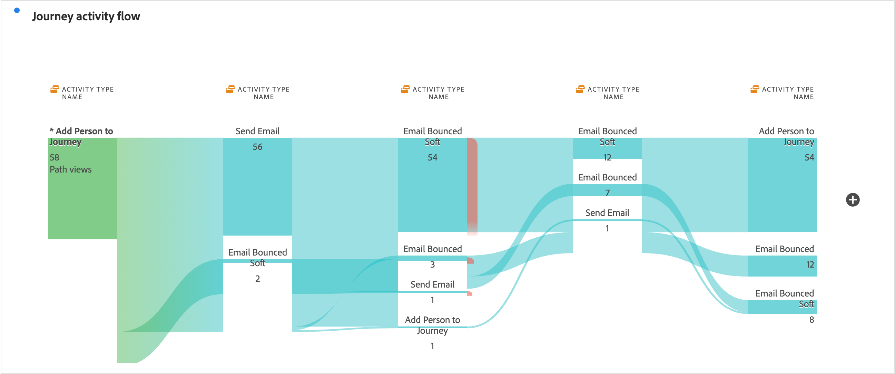

# Bericht zu Personen-Journey

<!-- SPHR-39120: UX plans to move the Journey activity flow tile to the top of the report. Update the tile order in this page when that ships. -->

Klicken Sie **[!UICONTROL Bericht anzeigen]**, um eine Live- oder abgeschlossene Personen-Journey anzuzeigen, deren Leistungsmetriken und Aktivitätsfluss angezeigt werden. Nach dem Öffnen des Berichts können Sie mehrere Journey auswählen, die in den Bericht aufgenommen werden sollen.

>[!PREREQUISITES]
>
>Um diesen Bericht anzuzeigen, benötigen Sie die Berechtigung **[!UICONTROL B2B-Personen-Journey-Berichte anzeigen]** [Berechtigung](../start/permissions-reference.md).

_Bericht anzeigen :_

1. Öffnen Sie eine **[!UICONTROL Live]**- oder **[!UICONTROL Finished]**-Personen-Journey aus der Liste _[!UICONTROL Personen-Journey]_.
1. Wählen Sie in der Journey-Kopfzeile **[!UICONTROL Bericht anzeigen]**.

   {width="600" zoomable="yes"}

Sie können [ Datumsbereich für ](./reports-overview.md#change-the-date-range) Bericht ändern.

Wählen **[!UICONTROL oben]** Bericht „Freigeben“ aus, um die Daten herunterzuladen oder ihren Export zu planen. Siehe [_Exportieren eines Berichts_](./reports-overview.md#export-a-report) in der Übersicht über Berichte.

{width="700" zoomable="yes"}

## Filter {#filters}

Der Bericht zeigt zunächst die Journey an, von der aus Sie sie geöffnet haben. Verwenden Sie die Filter oben im Bericht, um zu ändern, welche Journey und Rollen enthalten sind.

* **[!UICONTROL Journey-Name (Ereignis)]** - Legen Sie die Voreinstellung auf die Journey fest, von der aus Sie den Bericht geöffnet haben. Öffnen Sie die Filterliste und wählen Sie die einzuschließenden Journey aus. Sie können mehrere Journey auswählen.
* **[!UICONTROL Persona (Ereignis)]** - Filtern des Berichts nach Personen, die mit einer bestimmten [abgeleiteten Persona](../audiences/personas.md#filter-by-derived-persona) übereinstimmen. Der Standardwert lautet [!UICONTROL Kein Filter].

{width="700" zoomable="yes"}

Um nach Persona zu filtern, öffnen **[!UICONTROL die Filterliste]** Persona (Ereignis)“ am oberen Rand des Berichts und wählen die einzuschließenden Werte aus.

Wählen **[!UICONTROL Alle zurücksetzen]**, um die Berichtsfilter zurückzusetzen.

## Personenstatus und Interaktion {#person-status-and-engagement}

Dieser Abschnitt enthält vier Kacheln:

* **[!UICONTROL Status der Personen auf der Journey]** - Unterteilt Personen auf der Journey in _[!UICONTROL Abgeschlossen]_ und _[!UICONTROL In Bearbeitung]_ Kategorien mit entsprechenden Prozentsätzen.
* **[!UICONTROL Abgeschlossene Personen im Zeitablauf]** - Ein Liniendiagramm, das die Anzahl der Personen erfasst, die die Journey im ausgewählten Datumsbereich abgeschlossen haben.
* **[!UICONTROL Interaktive vs. nicht interaktive Personen]** - Unterteilt Personen auf der Journey in _[!UICONTROL Interaktive]_ und _[!UICONTROL Nicht interaktive]_ Kategorien mit entsprechenden Prozentsätzen.
* **[!UICONTROL Engagierte Personen]** - Die Gesamtzahl der Personen, die sich als am Journey beteiligt qualifizieren.

## E-Mail-Leistung {#email-performance}

Die [!UICONTROL E-Mail]Leistung) zeigt Versand- und Interaktionsmetriken für jede auf der Journey gesendete E-Mail an. Dieselben E-Mail-Metriken für alle Journey finden Sie im [E-Mail-Interaktionsbericht](./email-engagement-report.md).

{width="700" zoomable="yes"}

[!UICONTROL E-Mail]Leistung) Tabellenspalten:

* [!UICONTROL Email Name] - Name der E-Mail.
* [!UICONTROL Gesendet] - Anzahl der gesendeten E-Mails.
* [!UICONTROL Zugestellt] - Anzahl der zugestellten E-Mails.
* [!UICONTROL  % Zugestellt] - Anzahl der zugestellten E-Mails dividiert durch die Anzahl der gesendeten Nachrichten.
* [!UICONTROL Geöffnet] - Anzahl der Öffnungen der E-Mail durch Empfänger.
* [!UICONTROL  % geöffnet] - Anzahl der geöffneten E-Mails dividiert durch die Anzahl der zugestellten Nachrichten.
* [!UICONTROL geklickt] - Anzahl der Klicks auf einen Link in der E-Mail.
* [!UICONTROL  % angeklickt] - Anzahl der angeklickten E-Mails dividiert durch die Anzahl der zugestellten Nachrichten.

## Journey-Aktivitätsfluss {#journey-activity-flow}

Die Visualisierung des [!UICONTROL Journey]Aktivitätsflusses zeigt den Pfad, den Personen durch den Journey gehen, beginnend mit der Aktivität _[!UICONTROL Person zum Journey hinzufügen]_. Jeder Knoten zeigt die Anzahl der Ansichten für diese Aktivität an.

{width="500" zoomable="yes"}
